# local_harness_note — Not

A minimal second-brain Android app: quick notes, hierarchical `#tags`, voice clips and
videos on reminders, HTML lessons with active recall, on-device Gemma, a floating
quick-note bubble, and Claude access through an MCP relay. Notes stay on the phone.

## Download

**[⬇ Not 1.1.0 — APK (Android 11+, arm64)](https://github.com/DenizTanisman/local_harness_note/releases/latest/download/not-1.1.0-arm64.apk)**
· [all releases](https://github.com/DenizTanisman/local_harness_note/releases)

Install it on the phone (allow "install unknown apps" for your browser or file manager
when Android asks). The on-device Gemma model (~2.6 GB) downloads once from
*Ayarlar › Gemma*. The Claude connection needs your own Cloudflare + Firebase setup —
see [`worker/setup.sh`](worker/setup.sh).

## Screenshots

| Notes | Categories | A note | Tag page & merge |
|---|---|---|---|
| 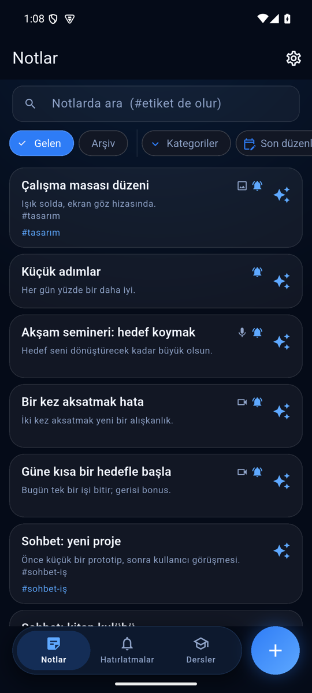 | 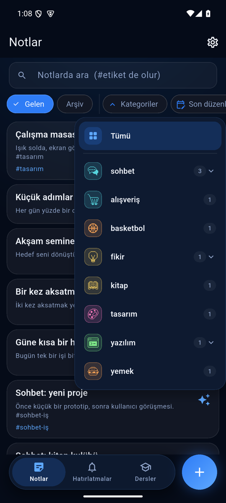 | 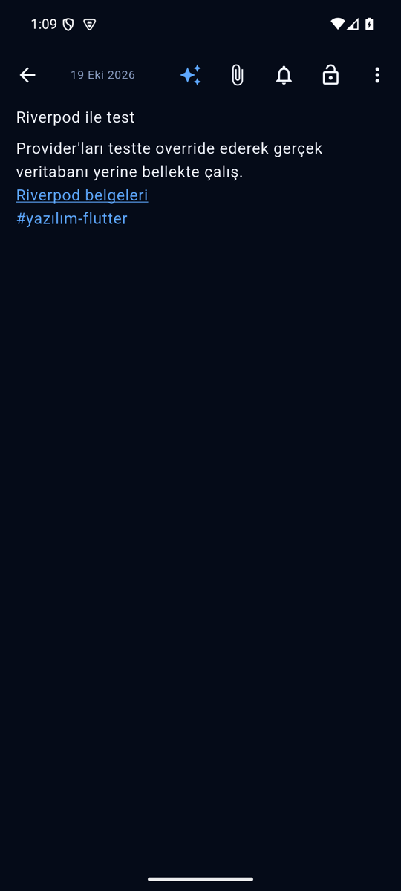 | 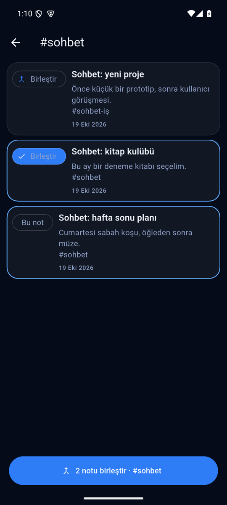 |

| Reminders by length | Video in a note | Reminder notification | Floating player |
|---|---|---|---|
| 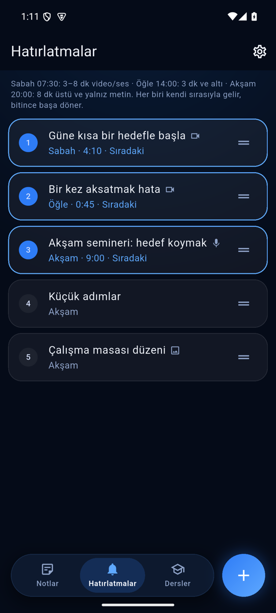 | 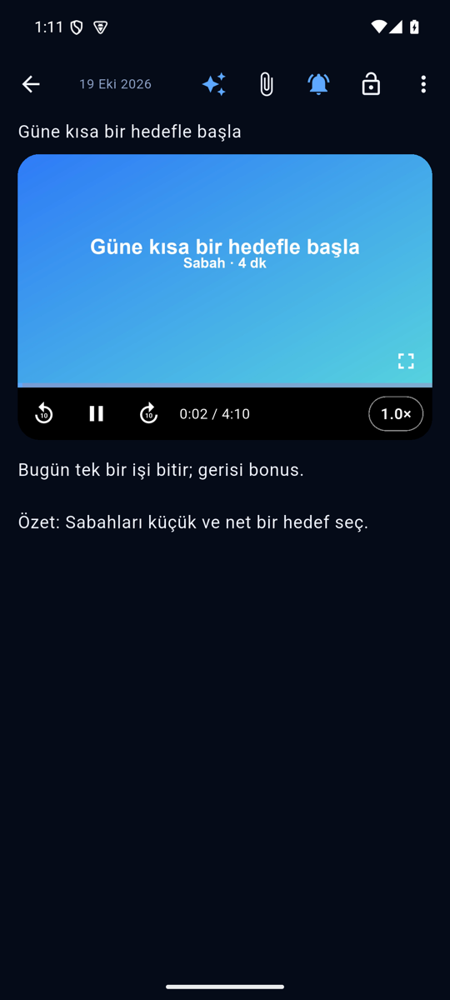 | 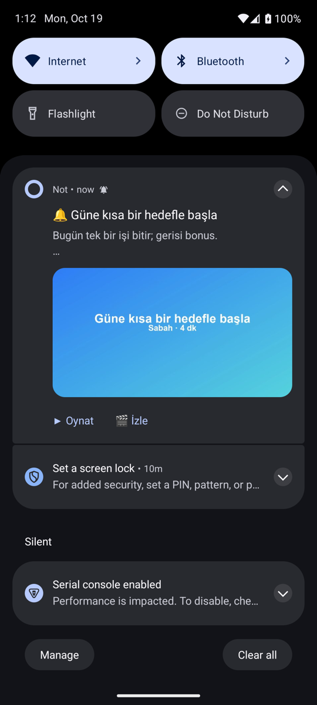 | 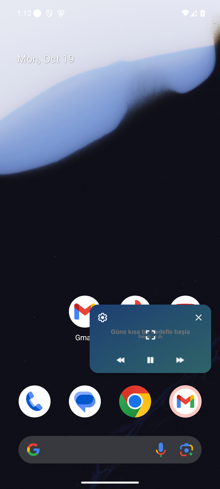 |

| Lessons | Lesson with Recall | Recall question | Result | Wrong cards marked |
|---|---|---|---|---|
| 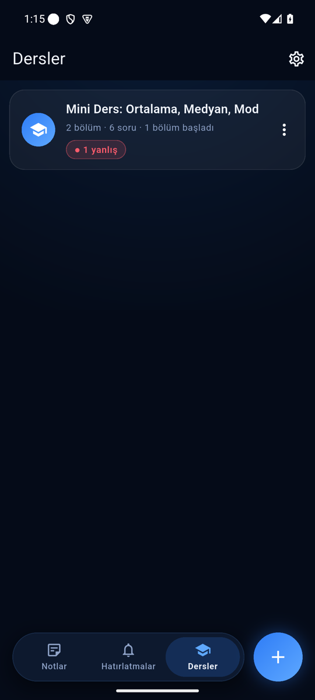 | 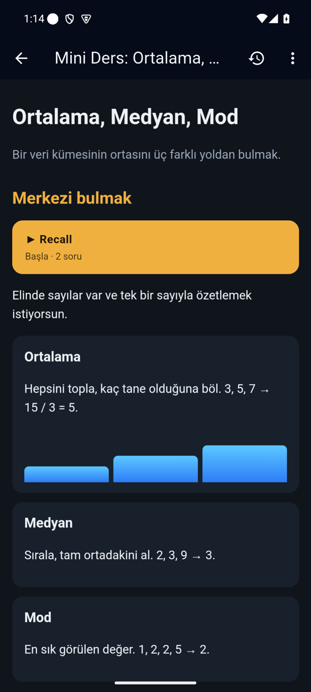 | 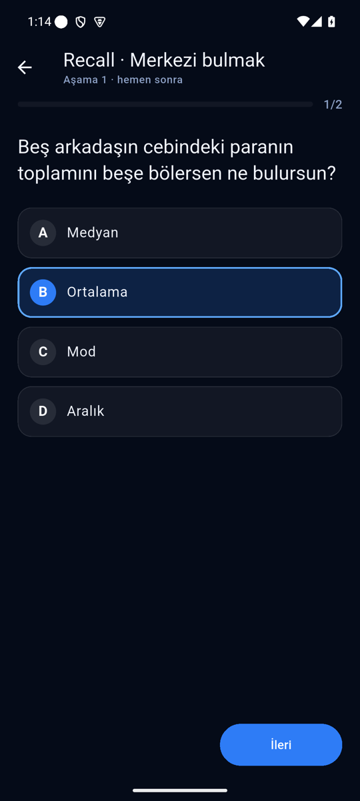 | 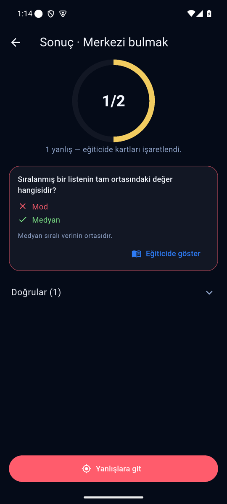 | 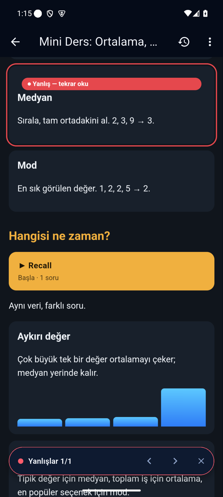 |

All screenshots use demo data ([`tool/screenshots/`](tool/screenshots/)).

## What's inside

- **Notlar** — plain-text notes, `#tags` with sub-tags (`#question-llm`), Turkish-aware
  search, a categories menu with pixel icons, sorting, private notes, versions, tappable
  links that open in their own app (YouTube, Instagram, X …).
  - **Tag pages** — tap a `#tag` in a note: every note with it, last edited first. Pick
    others with **Birleştir** and they merge with the note you came from into one new
    note under that tag; the originals go to the archive (undo, or restore from there).
  - Erasing a note's whole text asks first and moves it to the archive (kept 45 days).
- **Voice clips, pictures and videos** — record, pick, or share a WhatsApp voice
  message / video to Not. In a note a video plays in place with 10 s back / forward and
  0.5×–4× speed.
- **Hatırlatmalar** — an ordered list, three notifications a day, each part of the day
  with its own notes: **07:30** clips of 3–8 min, **14:00** 3 min or shorter,
  **20:00** longer ones and text-only notes. A reminder shows its picture or video
  frame; **▶ Oynat** plays the sound without opening the app, **🎬 İzle** floats the
  video over whatever is on screen (picture-in-picture).
- **Dersler** — HTML tutorials with active recall ([format](docs/lesson-format.md)): a
  ▶ Recall button per section, multiple choice, results only when the day's questions
  are done, wrong answers marked in the tutorial with a "Yanlışlar ◀ ▶" jump bar,
  reviews 1, 3 and 5 days later with reminders that open the test.
- **✨ Gemma** — runs on the phone: *Toparla*, *Hizala* (layout only, same words) or
  your own prompt; the answer is editable before it replaces the note.
- **Capture** — share sheet, home-screen widget, floating quick-note bubble.
- **Claude (MCP)** — a Cloudflare Worker wakes the phone over FCM; tools run on the
  phone's own database (private notes are never sent, there is no delete tool). The
  same relay takes notes with a clip from the Mac:
  [`tools/ses-to-not`](tools/ses-to-not/) turns a clip and its Whisper transcript into
  a reminder (title, clip, laid-out text, summary).

Details: [HARNESS.md](HARNESS.md) · spec: [docs/second-brain-spec.md](docs/second-brain-spec.md)
· hub contract: [docs/HUB_CONTRACT.md](docs/HUB_CONTRACT.md).

## Build

```sh
flutter pub get
flutter build apk --release --target-platform android-arm64
(cd worker && npm install && npm test)   # relay end-to-end tests
```

Pixel category icons: [Streamline "Pixel"](https://www.streamlinehq.com/icons/pixel),
CC BY 4.0 — see [assets/icons/pixel/LICENSE.md](assets/icons/pixel/LICENSE.md).
